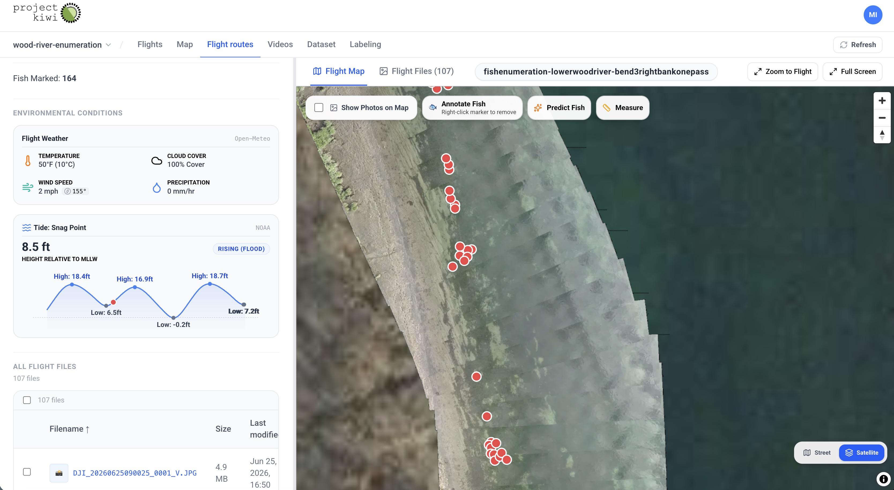

# Salmon Enumeration Dashboard



The **Salmon Enumeration Dashboard** ([salmon.projectkiwi.io](https://salmon.projectkiwi.io)) is a web application for collecting, reviewing, mapping, and labeling aerial drone imagery and video for salmon enumeration.

The first version went live on May 25, 2026, and project partners were invited on June 16, 2026. Throughout the 2026 field season it served as the central hub for the field crew, UW-FRI, BBRSDA, and BBEDC. Access is invite-only, using passwordless email sign-in with one-time codes and role-based permissions (`read`, `read-write`, and `admin`).

## 2026 Season Summary

By the end of the 2026 season, the dashboard held **331 drone flights** across **131 flight plans** (repeating missions such as hourly bank-count hovers) and roughly **27,300 files**:

- **~26,700 still images**, including mapping image sets used to build orthomosaics
- **331 hover videos**, totaling about **32 hours** of footage
- **RTK/PPK positioning logs** for 74 flights
- **Per-file metadata**: GPS coordinates, capture time, parent flight and flight plan, pixel dimensions, and review status (`not_reviewed`, `in_review`, `reviewed`)
- **Salmon labels and AI predictions**, stored as GeoJSON annotations and tiled labeling points (one point per fish, or a point with a `fishCount` for tight groups), each with a confidence score
- **Environmental context**: weather, wind, cloud cover, and NOAA tide predictions alongside each day's flights

## Organization and Views

Data is organized hierarchically: **Project -> Flight Plan -> Flight -> Files**.

- **Today and Dashboard**: A daily calendar of flights per site paired with local weather, wind, cloud cover, and tide curves.
- **Flight Plans and Flights**: Detailed views of every mission with image galleries, a streaming video player, an orthomosaic and georeferenced-image viewer, survey type tracking (`migration` vs. `spawning`), and triggers for orthomosaic generation and ML salmon detection.
- **Map**: Interactive MapLibre GL view of all flights. Survey sites are drawn as polygon geofences, and uploaded files are automatically tagged to sites by location.
- **Videos**: A unified browser for hover videos, automatically compressed after upload for smooth streaming over field connections.
- **Labeling and Dataset**: Tiled labeling queues where annotators click points on salmon in still images and extracted video frames, plus a dataset manager that allocates labeled files across `train`, `val`, and `test` splits (~1,450 labeled images in 2026).
- **Admin**: User invites and role management, API key issuance, interactive REST API documentation (`/admin/api-docs`), and video compression monitoring and backfill controls.

## Data Ingestion and Pipeline

1. **Automated DJI FlightHub 2 pipeline**: Dock-based ("drone in a box") and crew-flown drones upload media to DJI FlightHub 2. FlightHub fires a webhook to an AWS Lambda function (originally written by Ian Chiu, in `dji-pipeline/`), which copies flight media to Amazon S3, organizes files under the matching flight plan, and runs ffmpeg video compression. With Starlink at the field site, flights appeared in the dashboard in near real time.
2. **Manual uploads**: Field crews can upload flights directly in the browser via **Log flight**, using presigned S3 uploads with automatic EXIF metadata extraction and GeoTIFF registration.
3. **REST API (`/api/v1`)**: Scripts and ML pipelines read and write projects, flight plans, flights, files, labeling tasks, orthomosaic tasks, and annotations using bearer API keys managed in the Admin panel.

## Tech Stack

- **Frontend and Server**: TypeScript, Next.js 16 (App Router), React 19, Tailwind CSS v4, shadcn/ui, and MapLibre GL, hosted on Vercel
- **Database**: SQLite / libSQL (local `data.db` or Turso) via Drizzle ORM
- **Object Storage**: Amazon S3 for raw imagery, compressed videos, Cloud-Optimized GeoTIFFs (COGs), and static WebP map tiles
- **Ingestion Pipeline**: Python on AWS Lambda (FlightHub 2 webhook handler and ffmpeg video compressor), deployed with AWS CDK (`dji-pipeline/`)
- **Geospatial and Compute Workers**: Python services on Modal (`modal/`) running OpenDroneMap (NodeODM) for orthomosaics, direct image georeferencing, dynamic/static map tiling, video frame extraction, and ML inference
- **Authentication and Email**: Passwordless OTP and invite emails sent via Postmark and React Email, with JWT cookies (`jose`)
- **Testing**: Vitest and Testing Library for unit/integration tests, Playwright for end-to-end tests

## Repository Layout

```text
app/            Next.js App Router pages, server actions, and API routes (/api/v1, /api/ml, /api/tiles, etc.)
components/     Shared UI components (shadcn/ui)
lib/            Database schema (Drizzle), S3 helpers, auth/session logic, EXIF parser, geofencing, weather/tides
drizzle/        Generated SQLite migrations
dji-pipeline/   AWS CDK stack and Python Lambda functions for FlightHub 2 ingestion and video compression
modal/          Modal Python workers for OpenDroneMap, georeferencing, and COG tile serving
emails/         React Email templates for login OTPs and user invitations
scripts/        Database seeding and maintenance utilities
__tests__/      Vitest unit, component, and integration tests
e2e/            Playwright end-to-end browser tests
```

## Getting Started

Running a full deployment requires external infrastructure (Amazon S3, Postmark, and optionally Turso, Modal workers, and the AWS CDK pipeline), though core web development works locally against a SQLite file.

### 1. Install dependencies

```bash
pnpm install
```

### 2. Configure environment variables

Create a `.env.local` file in the project root:

```bash
# Auth & App
AUTH_SECRET=replace-with-a-random-32-byte-secret
NEXT_PUBLIC_APP_URL=http://localhost:3000
NEXT_PUBLIC_BASE_URL=http://localhost:3000

# Database (omit both to use local ./data.db SQLite file)
TURSO_DATABASE_URL=
TURSO_AUTH_TOKEN=

# Email (Postmark, for OTP codes and user invites)
POSTMARK_SERVER_TOKEN=
EMAIL_FROM=noreply@yourdomain.com

# Storage & Pipeline (Amazon S3 / Lambda)
AWS_REGION=us-west-2
AWS_ACCESS_KEY_ID=
AWS_SECRET_ACCESS_KEY=
S3_BUCKET_NAME=
COMPRESS_LAMBDA_FUNCTION_NAME=

# Geospatial & ML Workers (Modal / ODM, optional for core UI)
MODAL_TILE_SERVER_URL=
MODAL_TILE_TOKEN=
MODAL_ODM_WORKER_URL=
MODAL_ODM_WORKER_TOKEN=
MODAL_GEOREF_WORKER_URL=
MODAL_GEOREF_WORKER_TOKEN=
MODAL_PREDICTION_URL=
ODM_NODE_URL=

# DJI FlightHub 2 Sync (optional)
DJI_OPENAPI_KEY=
DJI_WEBHOOK_URL=
```

### 3. Initialize the database and seed an admin user

Apply Drizzle migrations and create your initial admin account (so you can sign in without a prior invite):

```bash
pnpm db:migrate
pnpm db:seed you@example.com
```

### 4. Start the development server

```bash
pnpm dev
```

Open [http://localhost:3000](http://localhost:3000) and sign in with the seeded email address.

## Useful Commands

| Command | Description |
| --- | --- |
| `pnpm dev` | Start the Next.js development server |
| `pnpm build` | Run database migrations and build for production |
| `pnpm lint` | Run ESLint |
| `pnpm db:migrate` | Apply Drizzle SQL migrations |
| `pnpm db:studio` | Open Drizzle Studio to inspect the database |
| `pnpm db:seed <email>` | Bootstrap an initial `admin` user |
| `pnpm test:unit` | Run Vitest unit and integration suites |
| `pnpm test:e2e` | Run Playwright end-to-end tests |
| `pnpm test` | Run all unit and end-to-end tests |

